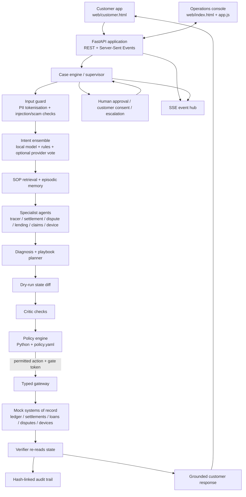

# Architecture and workflow

## 1. System context

Paytm Resolve is a local, single-process FastAPI prototype with two browser clients: an operations console and a customer support app. The backend owns the case engine, simulated systems of record, model routing, policy decisions, typed gateway, evaluation harnesses, and event stream.

## 2. Repository map

| Component | Code | Responsibility |
|---|---|---|
| HTTP/API boundary | `resolve/api/app.py` | FastAPI routes, state access, static pages, SSE, voice and evaluation endpoints |
| Case orchestration | `resolve/engine.py` | Intake-to-close workflow, agent coordination, case state and metrics |
| Input guard | `resolve/guard.py` | Injection/scam signals, cleaning and PII tokenisation |
| Intent model | `resolve/ml/intent_model.py`, `ensemble.py`, `corpus.py` | Trained local classifier, rule/model combination and synthetic corpus |
| Provider adapters | `resolve/llm/` | Local fallback, Sarvam, Claude and OpenAI-compatible adapters; task router |
| Agent roles | `resolve/agents/` | Structured reasoning, domain specialists and bounded investigator |
| Knowledge | `resolve/knowledge/kb.py` | SOP search using lexical ranking and trigram similarity |
| Memory | `resolve/memory/episodic.py` | Similar-case recall in the prototype |
| Policy | `resolve/policy/engine.py`, `policy.yaml` | Tier assignment, confidence/risk/value rules and category autonomy mode |
| Tool gateway | `resolve/gateway/gateway.py` | Tool schemas, authorization, gate tokens, limits, idempotency and undo |
| Mock systems | `resolve/mockworld/world.py` | Simulated transactions, parties, settlements, loans, disputes, claims and devices |
| Audit | `resolve/audit.py` | Hash-linked audit records and audit-pack rendering |
| Eventing | `resolve/events/stream.py` | In-process SSE fan-out and issuer incident detection |
| Evaluation | `resolve/evals/`, `resolve/ml/eval.py`, `conformal.py` | Scenario, synthetic, intent, rigor and benchmark measurements |
| Browser clients | `web/` | Operations dashboard and customer interaction UI |

## 3. Case lifecycle

### Intake and guard

The customer app submits a party identifier, message, and channel to `POST /api/cases`. The engine detects language and applies guard logic before model-based classification. Sensitive values are tokenized; suspicious instruction patterns are flagged or stripped from the trusted task text. The guard is a first layer, not a substitute for a complete security boundary.

### Intent and evidence gathering

The local intent model and deterministic rules form the baseline. When configured, the router can add a provider vote. The ensemble combines signals; disagreement or low confidence can lower the confidence and lead to a human path. The knowledge module retrieves SOP snippets. Specialist tools read simulated transaction, settlement, loan, dispute, claim, or device records through the gateway.

### Diagnosis and action proposal

Specialists return structured findings. The planner maps those findings to known action tools/playbooks. Novel cases can use the bounded investigator path; the investigator is designed as read-only and returns a hypothesis and recommendations for a human rather than an executable write.

### Dry-run, critic, and policy

Each proposed write is previewed as a state diff. The critic checks the plan for requester authorization, evidence support, policy citation, injected/smuggled parameters, and amount bounds. The policy engine evaluates category, confidence, risk flags, action class, configured autonomy mode, and value limits.

The YAML currently labels the policy `policy-v3`. The tier model is:

| Tier | Intended meaning | Typical handling |
|---|---|---|
| T0 | Observe / safe non-write / ask for information | No autonomous high-impact write |
| T1 | Act and notify, with undo where supported | Low-risk, bounded action after checks |
| T2 | Human approval required | Proposed write pauses for operator approval |
| T3 | Human-only / escalation | No agent-executed write |

The precise decision is determined by `resolve/policy/engine.py` plus `resolve/policy/policy.yaml`; this table is an orientation, not a replacement for the policy implementation.

### Gateway and verification

The gateway is the write boundary. It validates the tool name and argument schema, checks the gate token bound to the exact action arguments, enforces object-level authorization and configured caps, and applies idempotency. Reversible actions create a compensation/undo entry where supported. After execution, the verifier re-reads the simulated record and checks the expected effect before the case is marked complete.

### Response and audit

The response composer uses verified case facts. Faithfulness checks are intended to prevent unsupported transaction identifiers and amounts from appearing in customer-facing text. Audit events are hash-linked and can be exported for inspection. Cases needing approval, consent, or a specialist are left pending or escalated rather than silently closed.

## 4. Model/provider routing

The router can use:

- **Local:** trained intent model, deterministic rules, and grounded templates. This is the fallback and supports an offline demo.
- **Sarvam:** optional Indic intent/reasoning, translation, speech-to-text, and text-to-speech adapters.
- **OpenAI-compatible provider:** optional adapter for compatible endpoints such as Gemini-compatible APIs, Groq, OpenRouter, Ollama, LM Studio, or vLLM, depending on configuration.
- **Anthropic Claude:** optional reasoning/investigation adapter.

Provider availability is driven by environment configuration. The presence of an adapter in the repository does not imply it is enabled in a particular run. Inspect `/api/config` and `/api/ai/overview` for active providers.

## 5. Runtime and persistence model

- FastAPI serves both browser applications and API routes.
- The supplied run scripts bind to `127.0.0.1:8001` by default.
- The live event hub uses in-process queues and Server-Sent Events.
- Case engine and mock world are initialized in process. They are demo state, not durable production storage.
- Heavy evaluation/benchmark work is offloaded from the async request path so the live event loop is less likely to stall during the demo.

## 6. Important trust boundaries

1. Customer text is untrusted input.
2. Model output is advisory; it is not an authorization credential.
3. Policy decisions are computed outside prompts.
4. The gateway validates and enforces writes.
5. The mock world is not an actual financial system; no real payment or settlement is performed.
6. The local prototype does not provide production identity, authentication, tenant isolation, durable workflow recovery, or operational controls.

For gaps and the recommended migration, see [Known limitations](KNOWN_LIMITATIONS.md) and [Production path](PRODUCTION_PATH.md).
